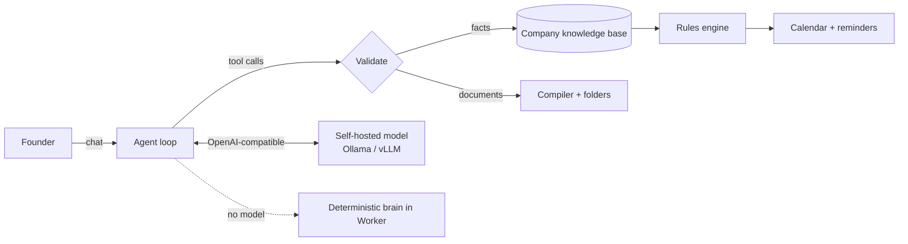

# Niyam — Startup Compliance Tracker

An AI agent for first-time Indian founders. You talk to it in plain language;
it keeps a record of the business on your own server, works out which
registrations, licences and filings apply, when each is due, who it is owed to
and what a missed deadline costs, drafts the paperwork, and keeps reminding you
until you mark it done.

Built for the **Ground Zero Buildathon (Studentpreneurs, with AI Agents)**,
Impact Hub, Hyderabad, 14 November 2026.

> Guidance, not legal advice. Deadlines and penalties in the catalogue reflect
> rules as generally known and have **not** been verified against official
> portals. Verify every entry with a practising CA before relying on it.

## What is in the product

| Area | Route | What it does |
| --- | --- | --- |
| Landing | `/` | Public: promise, problem, the ten features, the seven-step journey, straight answers, sign-in |
| Sign in | `/login` | Clerk sign-in; every other route below needs it |
| Agent | `/agent` | Free-form chat that reads and writes the company record, answers what is due, drafts filings, and shows its tool calls |
| Obligations | `/obligations` | Every rule that applies, with the reason written from your answers and the rule version |
| Calendar | `/calendar` | Dated deadlines for 60 days back to 12 months ahead, colour coded, with an “on event” lane and .ics export |
| Deadline | `/deadline/:id` | Authority, penalty, plain-words explanation, checklist, compiler, reminders, mark done, “ask the agent” |
| Documents | `/documents` | Compiled folders with drafts, cover sheets, checklists, manifests and ZIP download |
| Reminders | `/reminders` | Simulated clock, the daily job, the idempotent delivery log, WhatsApp preview |
| Share | `/share` | Hashed share links, permissions, expiry, revocation, activity log |
| CA view | `/s/:token` | The accountant’s scoped, read-mostly view |
| Find a CA | `/ca` | Weighted matching with reasons and a score breakdown |
| Import | `/import` | CSV upload, header detection, mapping preview, validated import |
| Company record | `/company` | Every fact the agent holds, with provenance, editable and validated |

`/interview` redirects to `/agent`; the guided slot-filling flow is gone.

## The agent and the company record

The agent is one conversation over one **company knowledge base**
(`src/shared/knowledge.ts`). Roughly thirty facts, grouped as identity, people,
money, registrations, investors and operations. Each stored fact carries:

- its value,
- **where it came from** (`agent`, `import`, `manual`, `document`),
- when it last changed.

Every write goes through a field registry with type checks: allowed company
types and states, numeric ranges, date formats and ranges, PAN and GSTIN
patterns (stored masked), director and investor lists. A rejected value is
reported and never stored. The rules engine reads a profile derived from the
facts, so:

- correcting one answer re-runs the rules;
- deadlines that no longer apply are removed unless already done;
- done items keep their status and who marked them.

The agent uses **tools**, and the same tools run whether a model is driving or
not:

| Tool | What it does |
| --- | --- |
| `update_company` | Validates and merges facts read from the message |
| `read_company` | Reads the record back |
| `list_obligations` / `get_calendar` | Rules and dated calendar, never invented |
| `draft_documents` | Compiles one filing, all open filings, or the overdue ones |
| `explain_item` | Explains a filing from its record, with the faithfulness check |
| `mark_done` | Marks a deadline done, which stops its reminders |
| `find_ca` | Weighted CA matches with reasons |

The reply shows the tool calls it made, the facts it changed and links to the
pages involved. Documents the compiler can draft for any filing include a filing
cover sheet, board resolution, AGM notice, financial summary cover, director KYC
sheet, share-allotment data (FC-GPR), employee master, GST data sheet and an
authority letter — plus a per-folder checklist and manifest, all marked
**DRAFT, review before use**.

### Two engines, one contract

1. **Self-hosted model.** Set `MODEL_BASE_URL` (and `MODEL_NAME`) to an
   OpenAI-compatible server on your own hardware. Ollama, llama.cpp and vLLM all
   qualify. The agent sends the masked question plus tool schemas, executes the
   tool calls it gets back, feeds the results in, and answers — at most three
   model turns. `POST /api/agent/message` returns which engine answered.
2. **On-server brain.** With no model configured or reachable, a deterministic
   brain in the Worker performs the same extraction, validation and tools. The
   app stays usable; the chat header says which engine is running.

```sh
# optional: run a real local model
ollama pull qwen2.5:3b
cp .dev.vars.example .dev.vars     # MODEL_BASE_URL=http://localhost:11434/v1
bun run dev
```

`.dev.vars` is gitignored. The browser never sees the model URL or any key; the
Worker makes the call. Model output cannot create a deadline: dates, penalties
and applicability only ever come from the rules engine.



## Run it

```sh
bun install
bun run dev        # http://localhost:5305 (Vite + the Worker in workerd)
bun run build      # dist/client (assets) + dist/niyam/index.js (Worker)
bun run typecheck
```

This build was verified with Node 22 running the Vite binary directly
(`node node_modules/vite/bin/vite.js --port 5305`). The Cloudflare Vite plugin
needs Node’s fetch and does not work under Bun’s runtime.

## Privacy and guardrails

- The record, the rules, the compiler and the agent all run together on the same
  server. Nothing is sent to a third-party AI provider.
- PAN, GSTIN, phone and email are **masked before any model call**; stored
  identifiers are masked too.
- The model proposes facts; **validation decides**. A bad value is rejected with
  a reason. The model has no tool that can add or move a deadline.
- Explanations are checked: every number in an answer must appear in the rule
  record, or the stored plain-words text is shown instead.
- Every screen carries “guidance, not legal advice”, and rules without a
  reviewer sign-off show a “not yet verified” badge.
- The activity log records profile changes, shares, downloads and CA actions.

## The rules engine

22 rules, version `2026.1`, encoded as data (Appendix A of the handbook):

- Conditions compose with `all` / `any` / `not` and `eq` / `in` / `gt` / `gte` /
  `lt` / `lte` over `entity`, `state`, `turnover`, `employees`, `sells`,
  `gst_registered`, `interstate`, `foreign_investment`, `incorporated_on`.
- Schedules: `monthly`, `yearly`, `multi`, `relative` (N days after
  incorporation), `derived` (N days after the AGM) and `event` for items with no
  fixed date. Yearly rules can declare a variant per company type.
- Window: 60 days in the past (so overdue items stay visible) to 365 days ahead.
  No deadline is generated before the incorporation date.
- Colour: red (overdue or ≤ 3 days), amber (4–30), green (> 30), grey (done),
  blue (waiting on an event). Every colour also carries a text label.
- Penalty estimators use structured fields (fixed, per-day, cap, % of turnover,
  interest) and are labelled indicative.
- Every rule renders with its version and a “not yet verified” badge until a
  reviewer records a `verified_on` date and source.

## Reminders

A daily job (09:00 IST) computes `left = due − today`; stages are 30, 7, 3, 1, 0
days, then `overdue-<today>` every day until done. The delivery log is the
idempotency key, so running the job twice never duplicates a message. Marking an
item done removes it from the job immediately. The page accepts a simulated
“today”. Email is the live channel; WhatsApp is a copy preview.

## Document compiler

Templates fill from the company record and are organised by financial year and
obligation (`FY2026-27/Companies-Act/AGM-2026-09-30/…`). Every folder gets a
filing cover sheet, the templates it can fill, a checklist and
`_manifest.json`. ZIPs are built by a small stored-entry ZIP writer
(`src/shared/zip.ts`) that runs in the Worker and in the browser. The compiler
reports fields it is missing rather than producing a half-empty document.

## Sign-in, and one record per client

`/` (the landing page), `/login` and `/s/:token` (a CA's share link) are public.
Everything else is behind `RequireAuth`, which sends a signed-out visitor to
`/login` and returns them where they were headed.

Sign-in is **Clerk** (`@clerk/react` in the browser, verified in the Worker).
The Worker verifies the session JWT with Web Crypto only — RS256 against
`CLERK_JWT_KEY`, or the instance JWKS when only `CLERK_JWKS_URL` is set — and
checks `exp`, `nbf` and the `azp` claim against `APP_ORIGIN`. No Node built-ins,
so it runs in workerd.

Each client owns exactly one row in D1 (`src/worker/db.ts`): `records` holds the
tracker state as JSON, scoped by the token's `sub`, never by an id the client
sends. `shares` is only a token-hash → owner index, rebuilt from the record on
every save, so a public share link resolves on any device without a session.

The app fails closed. With no Clerk configuration the protected routes answer
`503 auth_unconfigured`; the single exception is `ENVIRONMENT=development`,
which allows one fixed local user so the app stays testable locally.

Local development:

```sh
cp .dev.vars.example .dev.vars   # includes ENVIRONMENT=development
bun run dev
```

### Running app

| Where | URL |
| --- | --- |
| Local | <http://localhost:5305> |
| Deployed preview (Sites, preview environment) | <https://site-e7e807e9de1947f2bbfcc882cf250287.freebuff.page> |

Sign-in page: `/login`. The preview site id is
`7f3c1b2a-9d4e-4a6b-8c1d-2e3f4a5b6c7d`, with D1 binding `DB` and the public
`CLERK_PUBLISHABLE_KEY` set; `APP_ORIGIN` is injected by the platform.

### Clerk CLI on Windows

`npx -y clerk@latest` fails on Windows with `Unsupported or missing platform:
win32-x64` — the CLI resolves `@clerk/cli-win32-x64`, and npx never installs it.
Install that package into `.tools/` (gitignored) and call the binary directly:

```sh
# one-time install of the Windows binary (pinned to the working version)
npm i --no-save --prefix .tools/clerk-cli @clerk/cli-win32-x64@4.1.0
chmod +x .tools/clerk-cli/node_modules/@clerk/cli-win32-x64/bin/clerk.exe

CLERK=.tools/clerk-cli/node_modules/@clerk/cli-win32-x64/bin/clerk.exe

$CLERK auth login     # opens the browser; approve there
$CLERK link --app app_3M9T5KvPDUOlFtWOLHvhbJDgFUp
$CLERK env pull       # writes .env.local (gitignored)
$CLERK doctor         # logged in, linked, application reachable
$CLERK auth logout
```

Do **not** run `clerk init` here: the project already uses `@clerk/react`, and
init would create a second Clerk application and overwrite the keys. The
Dashboard entry for this project says “Next.js”, which does not describe this
Vite + Hono Worker app — use the app id above, not the framework guess.

`env pull` writes `VITE_CLERK_PUBLISHABLE_KEY` and `CLERK_SECRET_KEY` to
`.env.local`. Only the publishable key is needed at runtime: copy it into
`.dev.vars` as `CLERK_PUBLISHABLE_KEY` alongside
`APP_ORIGIN=http://localhost:5305`. Both files are gitignored.

## API

Computational routes are stateless pure functions of their payload. The record
and the share-link lookup need a session and the D1 store.

```
GET  /api/health
GET  /api/me                             the signed-in client, or 401
GET  /api/record                         that client's record, or null
PUT  /api/record                         { data }  same-origin only
GET  /api/share/:token                   public: scoped deadlines + checklists
POST /api/share/:token/done              public: needs mark-done permission
GET  /api/agent/status                   which engine, which model, reachable?
POST /api/agent/message                  { knowledge, message, history, today, statuses }
POST /api/interview/message              { profile, message, awaiting }   (legacy extractor)
POST /api/company                        { profile, today }
POST /api/company/import                 { csv }
POST /api/company/import/confirm         { csv, mapping }
POST /api/obligations                    { profile }
POST /api/calendar                       { profile, statuses, today }
POST /api/calendar.ics                   { profile, company, today }
POST /api/explain                        { record, language, question }
POST /api/deadlines/compile              { company, knowledge, deadline, today, ticked }
POST /api/folder.zip                     { files }
POST /api/share                          { permission, scope, expires_at }
POST /api/share/revoke                   { id }
POST /api/cas/match                      { profile, budget, today }
POST /api/cron/reminders                 { profile, statuses, today, log, company }
```

## Layout

```
src/
  shared/        deterministic core, shared by the Worker, the agent and the UI
    knowledge.ts   the company record: fields, validation, provenance, extraction
    agent.ts       agent loop, tools, self-hosted model client, fallback brain
    catalogue.ts   the 22 rules, CA directory, states, city map
    rules.ts       condition evaluation, reasons, penalty examples
    schedule.ts    date generation, colours, summary, month grouping
    gateway.ts     masking, deterministic parser, explanations, intents
    documents.ts   checklists, compiler, cover sheets, .ics
    reminders.ts   stages, messages, the idempotent job
    matching.ts    weighted CA scoring with reasons
    validation.ts  CSV parse, header mapping, value validation
    zip.ts         stored-entry ZIP writer
  worker/index.ts  Hono routes and model env
  lib/             browser store, API helper, copy
  components/      design system: buttons, fields, overlays, status, rows
  pages/           one page per route
```

## Data and limits of this build

- **Storage:** the record, statuses, checklist ticks, generated files, share
  links, reminder log and activity log live in D1, one row per signed-in client.
  A local copy is kept in `localStorage` as an optimistic cache and is cleared on
  sign-out. Share links resolve anywhere, because the token hash is indexed
  server-side.
- **No seeded data:** a new client starts with an empty company record. There is
  no sample company, no demo CA directory (the matcher is built, the directory
  is empty until real firms are onboarded), and no fabricated import row.
- **Model:** optional. Without `MODEL_BASE_URL` the deterministic brain answers;
  that path is fully built, not a placeholder. Translation of explanations into
  Hindi is not implemented (the field exists and falls back to English).
- **CA directory:** empty, with real scoring waiting for it (specialty 40%,
  location and language 20%, budget 15%, rating 15%, availability 10%). Payment
  never enters the score.
- **Documents:** HTML and CSV drafts (print to PDF), not Word or PDF generation.
- **State-specific rules** (professional tax, Shop licence) stay in the on-event
  lane until a state-specific rule is verified.

## Deploy

`deploy.json` points at the build output. After `bun run build`, deploy with the
Freebuff Sites tool (or the Sites API) from this directory. A deployment cannot
reach a model server running on your laptop: for the model path, self-host the
Worker with the model on the same network, or leave it on the deterministic
brain.

Sign-in needs four values, and the app refuses protected routes until the
server-side two exist:

| Where | Name | What it is |
| --- | --- | --- |
| build | `VITE_CLERK_PUBLISHABLE_KEY` | Clerk publishable key (`pk_test_…` / `pk_live_…`) |
| Worker var | `CLERK_PUBLISHABLE_KEY` | the same public key; the Worker derives the instance JWKS from it |
| Worker secret | `CLERK_JWT_KEY` | optional: verify against a PEM, with no network call per request |
| Worker var | `APP_ORIGIN` | the deployed origin, checked against the token's `azp` |

`CLERK_SECRET_KEY` is not needed: session tokens are verified against the public
key, so no privileged Clerk credential is stored. D1 comes from
`sites_add_storage` (`DB`, binding name `DB`); the schema creates itself on first
use.

The Vercel configuration (`vercel.json`) still builds the SPA for static hosting,
but has no D1, so its `/api/record` cannot work: the hosted app belongs on Sites.
